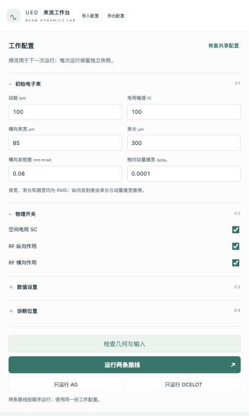
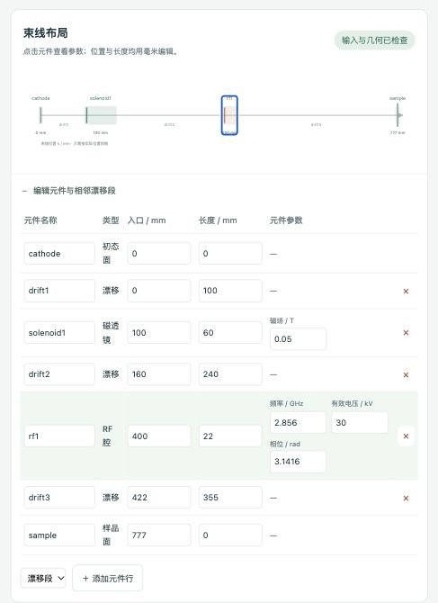
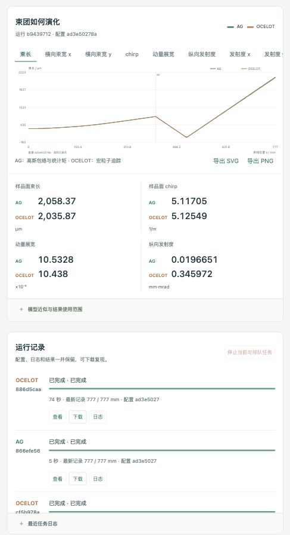

# UED Beam Dynamics Simulator

> **当前状态与下一步（2026-10-26）**：先看 [项目现状、边界与计算路线图](PROJECT_STATUS.md)。
> 后续计算使用 [计算卡模板](CALCULATION_CARD_TEMPLATE.md)，明确问题、参考、预算和完成条件。
> 旧报告按原日期保留；回归通过范围与模型物理适用范围分别记录。

超快电子衍射（UED）束流动力学模拟器 —— 基于物理的、可互验的双路线束流模拟框架。

- **AG 路线**：三维 RMS 包络与论文 SC Gx/Gy/Gz 演化（高斯闭合，完全确定性）
- **OCELOT 路线**：宏粒子追踪（漂移 SecondTM、磁透镜一阶 TransferMap + 可选 PIC 空间电荷）

两条独立路线共享配置结构，默认源为 `shared/beamline_config.yaml`（lattice 单一来源）；GUI 的编辑结果按任务冻结保存，显式 API 覆盖也写入有效参数。
验证框架在明确的初态、坐标和诊断面下比较 AG 与 OCELOT。

每种模型只有一套正式执行实现：日常 CLI 和验证适配调用同一个 driver。
验证层设置案例、比较结果；它不再独立创建初态、组装束线或执行 RF/SC。

---

## 项目目标

以"物理可解释、数值可验证、过程可追溯"为原则，构建一个 UED 束流动力学模拟器：

- 横向：螺线管聚焦、漂移、束团尺寸演化
- 纵向：RF 纵向透镜（chirp）与束团压缩、时间分辨
- 空间电荷：高斯模型（Kelisani 2023）与均匀椭球模型（Luiten 2004）
- 双路线互验：AG（解析包络）与 OCELOT（宏粒子）在相同参数下交叉校验

> 信任一个模拟结果的前提是「物理模型 + 数值实现 + 验证 + 文档」四者一致。
> 一个物理假设清晰、经过验证的简单模型，胜过复杂的黑箱模拟。
> —— 详见 [AGENTS.md](AGENTS.md)（AI 辅助科研编码规范）

---

## 架构总览

```
shared/beamline_config.yaml
        ├─ AG CLI ──────┐
        ├─ run_ag ──────┴→ AG.runner.run_from_config → AG 核心
        │
        ├─ OCELOT CLI ──┐
        └─ run_ocelot ──┴→ ued_beamline_v2.run_from_config
                          → build_lattice_from_shared → run_beamline → OCELOT
```

### 两个独立 backend

| | AG（解析包络） | OCELOT（宏粒子） |
|---|---|---|
| 方法 | 6D 包络 ODE（`solve_ivp` RK45） | 漂移二阶、磁透镜一阶 + 粒子统计；手工 RF kick |
| 模型 | Kelisani 2023 | OCELOT `generate_parray` + `Navigator` |
| 空间电荷 | Gaussian / Ellipsoid 解析模型 | PIC（NGP 沉积 + FFT 泊松求解） |
| 随机性 | 无随机抽样；数值仍依赖环境/求解器 | 配置化 seed；固定 seed 不代表跨环境逐位一致或统计收敛 |
| 发射度 | 三方向由配对 F/G 演化结果计算 | 从宏粒子的中心矩计算 |

比较原则：不要求逐点重合，按「方向 → 趋势 → 量级 → 定量解释」四级推进。

统一运行规则（2026-10-05）：显式参数覆盖 cfg；省略 SC 参数继承 cfg。
AG 默认关闭原有圆束螺线管耦合修正，显式 True 对照保留。
OCELOT 默认 dz 继承 `output.step_size_m`，无 SC 时补足尾步；原 1-mm 冻结回归须显式传 `dz=0.001`。
CLI 的 step1–3 仍关闭 SC，step4 才允许配置启用。RF 事件精确落在入口，实际位置写入 `meta.rf_events`；有SC时入口边界由原生Navigator调度。
详见 [路径合并变更记录](CHANGELOG_runner_unification_20261005.md) 和两条路线的 `runner_physics_note.md`。

当前状态（2026-10-21）：AG 演化三方向相空间面积，SC/RF/分段重建使用同一状态；横向 Gx/Gy 已补齐。无效的 `epsilon_nz_mm_mrad` 从共享 YAML 删除；旧配置读取时警告并忽略，初态由共享束长、`sigma_delta` 与零相关推导。两路线共同 JSON 保存实际 chirp、纵向相关矩、纵向发射度、RMS 时宽及实际参考量。RF 修正时间相位的 β 因子，采用有效积分电压、参考扣除与同一入口薄透镜；详见 [RF Physics Note](shared/rf_model_physics_note.md)、[横向 G Note](AG/transverse_g_physics_note.md) 和 [共同诊断](shared/beam_result_physics_note.md)。这些修复不等于完整有限腔、任意耦合或全 SC 物理验收；历史结果按原日期和公式解释。

---

当前系数计算（2026-10-22）：AG 的 F/G 共用原论文九项 α 的直接积分，已移除正式路径的样条表与边界截断；数值比例范围每轴 `[1e-6,1e6]`，域外明确报错。默认完整 AG 轨迹的所有系数请求均记录范围和误差估计；这不等于高斯闭合或完整 SC 已物理验收。详见 [α 数值 Physics Note](AG/alpha_coefficients_physics_note.md)。无 SC 的15条历史数组与2026-10-21版本逐位相同，旧基线未改。

历史短SC筛查（2026-10-22，使用当时传输方法，不能直接作为10月25日方法修正后的数值资格）：100 keV、初始85 μm圆束/300 μm束长、50 mm纯漂移，Q=1/10/100 fC、5种子与N/网格/步长有限控制。在本轮经验误差范围内，尺寸支持5%筛查目标；动量展宽仅1 fC支持2%，10/100 fC的AG均值分别低约3.95%/9.83%。纵向发射度分别低约5.80%/69.47%；没有另设纵向发射度阈值。横向发射度总值接近不代表SC增长已被重现。详见[研究定义与数值](validation/sc_scope_study_physics_note.md)及AI_HANDOFF第32节；不能外推完整束线/强压缩，也不代表PIC绝对真值。研究脚本要求显式`--out`，不改生产物理或既有结果。

## 目录结构

```
├── shared/                       # 共享层（单一来源）
│   ├── beamline_config.yaml      # ★ 唯一参数真源（beam + lattice + SC）
│   ├── params.py                 # 参数解析与派生量
│   ├── constants.py              # 共享物理常数（AG 旧核心尚有 ppm 级差异）
│   ├── beam_physics.py           # γ/β/p0 派生（BeamReference）
│   ├── ocelot_coords.py          # rparticles 语义访问（禁止裸索引）
│   ├── output_schema.py          # 统一输出 schema
│   ├── beam_result.py            # 正式实现与验证共用的结果容器
│   ├── run_contract.py           # section / 开关 / 来源规则（无力公式）
│   └── compare.py                # 双路线对比工具
│
├── AG/                           # AG 路线（物理修改先推导、验证）
│   ├── beam_dynamics_6d.py       # 6D 包络 ODE 与配对面积演化（核心）
│   ├── external_forces.py        # 螺线管 / RF 力模型
│   ├── beamline_sim.py           # 出图
│   ├── runner.py                 # 唯一正式 AG 执行实现
│   └── run_shared.py             # AG 统一输出适配层（薄适配器）
│
├── GPT模拟/                      # OCELOT 路线（主路由）
│   ├── ued_beamline_v2.py        # 主路由（lattice 单一来源，可 import）
│   └── {drift,solenoid,rf,space_charge}/   # 分节 benchmark
│
├── validation/                   # 验证框架
│   ├── backend.py                # 调用正式 driver 的兼容适配
│   ├── beam_result.py            # 共享容器的导入兼容
│   ├── run_all.py                # 注册回归（12 组；不包含全部专项）
│   ├── test_*.py                 # 分节/整线/路由等价测试
│   ├── CHECKPOINTS.md            # 验证检查点日志
│   ├── reports/                  # 验证报告
│   └── baselines/                # 冻结基线
│
└── scripts/
    └── sync_to_phone.py          # iCloud 同步 + gpt-review 打包
```

---

## 环境要求

- 当前保存的运行证据来自 macOS / CPython 3.12.2；Linux 与 Windows 的实际平台验收分别判断。
- 推荐使用 CPython 3.12 和 [requirements-gui.txt](requirements-gui.txt) 中的版本；Windows 安装器检查 CPython 3.12 x64，并拒绝不匹配的已有 `.venv`。
- PyPI 发行名是 `ocelot-collab`，Python 导入名是 `ocelot`。当前研究基于 26.6.1；不把所有后续 26.x 版本自动视为相同方法。

```bash
python -m pip install -r requirements-gui.txt
```

依赖 pin 不是完整环境锁或 Windows 安装成功证明。OCELOT 的 `energy` 输入是总能量 GeV：当前初始化沿用 `(E_keV + 511) * 1e-6`。

---

## 本地 GUI 使用步骤（v0.1）

GUI 可以编辑束团参数和元件位置，运行 AG / OCELOT，查看两路线曲线并导出结果。按下面的顺序即可完成一次计算。

### 1. 首次安装环境

先下载或克隆整个项目，解压后进入包含 `run_gui.py` 的项目根目录。

**Windows**：安装 **64 位 CPython 3.12**，然后双击根目录的 `安装环境.bat`。安装器会创建 `.venv` 并安装 `requirements-gui.txt` 中的依赖；看到错误时先按提示解决，再启动界面。

**macOS / Linux**：安装 CPython 3.12 后，在项目根目录打开终端，执行：

```bash
python3.12 -m venv .venv
source .venv/bin/activate
python -m pip install -r requirements-gui.txt
```

如果已经有装好项目依赖的 Python 环境，可以直接使用该环境。

### 2. 启动界面

- **Windows**：双击 `启动界面.bat`，会优先使用项目 `.venv`。
- **macOS**：已有项目依赖环境时可双击 `启动界面.command`。该脚本优先使用 `/opt/anaconda3/bin/python3`；若按上一步新建了 `.venv`，请用下面的手动命令，确保使用刚安装依赖的环境。
- **macOS / Linux 手动启动**：在项目根目录的终端执行：

```bash
source .venv/bin/activate
python -X utf8 run_gui.py --open
```

浏览器会打开 `http://127.0.0.1:8765`；没有自动打开时，手动输入该地址即可。运行期间保留启动器或终端窗口。

### 3. 设置束团和物理开关

在左侧“工作配置”中依次设置：

- **初始电子束**：动能、电荷幅值、横向束宽、束长、横向发射度和相对动量展宽。束宽、束长和展宽均按 RMS 定义。
- **物理开关**：空间电荷 SC、RF 纵向作用、RF 横向作用。
- **数值设置**：宏粒子数、随机种子、追踪步长、SC 调用间隔和网格。宏粒子数与网格用于 OCELOT；宏粒子数不代表束团的物理电荷。
- **诊断位置**：填写需要保存诊断量的束线位置，单位为 **mm**，可用逗号分隔。

首次使用可保留共享默认配置，先“只运行 AG”熟悉流程。右上角“导入配置”支持 JSON / YAML；左侧“恢复共享配置”可以重新载入默认配置副本。



*实际界面的参数区。截图载入的是已完成的历史配置，SC 与 RF 纵向、横向作用均开启；共享默认配置的 SC 与 RF 横向作用关闭。窄窗口时参数区显示在上方，宽屏时位于左侧。*

### 4. 编辑束线并检查几何

点击束线图里的元件，或展开“编辑元件与相邻漂移段”，修改磁透镜 / RF 的参数、入口和长度，也可以添加或删除元件行。界面的入口、长度和追踪步长用 **mm** 编辑，磁场用 **T**、RF 频率用 **GHz**、有效电压用 **kV**、相位用 **rad**。

修改元件位置或长度后，要同步调整相邻漂移段、样品面和诊断位置，让整条束线连续。具体例子见 [调整元件位置或长度](#调整元件位置或长度)。

点击 **“检查几何与输入”**，看到“输入与几何已检查”后再运行；若显示错误，按提示修正空隙、重叠或越界诊断面。界面不会自动移动其他元件。



*点击 RF 元件后展开编辑表：示例 RF 入口为 400 mm、长度 22 mm，样品面为 777 mm；表内同时显示相邻漂移和 RF 参数。*

### 5. 选择路线并运行

点击 **“只运行 AG”**、**“只运行 OCELOT”** 或 **“运行两条路线”**。两条路线使用同一份已保存配置，按 AG → OCELOT 的顺序执行。

在下方“运行记录”查看状态、进度和最新记录位置；点击“日志”查看计算信息。AG 在积分分段完成时更新位置，进度暂时不动不一定是卡住。需要中止时，点击 **“停止当前与排队任务”**。单条任务默认运行上限为 1800 秒。

### 6. 查看曲线和样品面参数

任务完成后，在“束团如何演化”里切换束长、横向束宽、chirp、动量展宽、三方向发射度、纵向相关矩和 RMS 时宽。鼠标悬停可读出实际记录位置与数值；图下方显示样品面参数。

“运行记录”中的“查看”可重新载入历史配置与结果。修改参数后需要再次运行；原曲线不会自动重新计算，界面会提示仍在显示之前的结果。



*同一配置下的两路线束长曲线、样品面参数和完成记录，均来自实际保存结果，已推进到 777 mm。绿色为 AG，橙色为 OCELOT；上方标签可以切换 chirp、展宽和发射度等观测量，下方可下载任务记录。这些截图用于说明操作，模型精度仍按各自适用范围判断。*

### 7. 保存结果并退出

- **保存输入**：右上角“导出配置”会先检查输入，再下载 JSON，方便下次导入。
- **保存曲线**：图下方“导出 SVG” / “导出 PNG”。
- **保存计算记录**：“运行记录”中点击“下载”，得到包含配置、状态和日志的 ZIP；成功完成的任务还包含结果 JSON。
- **退出服务**：在启动器或终端窗口按 `Ctrl+C`。仅关闭浏览器标签页不会停止后台服务。

运行数据默认保存在项目 `gui_runs/`。工作配置和每次计算各自保存，不覆盖 `shared/beamline_config.yaml` 或旧结果；重启后未完成任务标为中断，不自动重跑。

### 常见问题

| 情况 | 处理方式 |
|---|---|
| 提示端口被占用 | 手动启动时加 `--port 8766`，Windows 可运行 `启动界面.bat --port 8766`；访问 `http://127.0.0.1:8766`。 |
| 提示缺少 Python 模块 | 在启动 GUI 的同一个 Python 环境中执行 `python -m pip install -r requirements-gui.txt`。 |
| 输入或几何检查失败 | 检查元件入口与前段终点是否衔接、样品面是否在末端，以及诊断位置是否处于束线范围内。 |
| 任务失败或超时 | 先查看该任务“日志”和错误提示；未完成任务不会作为成功结果发布。 |

更详细的运行管理见 [GUI 使用说明](gui/README.md)。Windows 兼容代码已实现，**Windows 实机验收仍未完成**，见 [Windows 说明](gui/WINDOWS.md)。模型近似和结果适用范围见 [PROJECT_STATUS.md](PROJECT_STATUS.md)；“运行完成”表示计算与保存成功，物理精度需按对应工况的证据判断。

## 快速开始

### 1. 运行 OCELOT 主路由（GPT 路线）

```bash
# 支持 step 语义：1=drift, 2=+solenoid, 3=+RF, 4=+空间电荷
python3 "GPT模拟/ued_beamline_v2.py" --step 3
```

### 2. 运行 AG 路线（解析包络）

```bash
python3 AG/run_shared.py
```

### 3. 验证入口（耗时依设置和机器变化）

```bash
python3 validation/run_all.py            # 当前注册 12 组；通过不等于完整 SC 物理验收
python3 validation/test_r56_convention.py # 冻结表征（结果必须逐位不变）
```

`run_all.py` 会写入报告/检查点；只读审核应在隔离副本运行。

两条路线运行后都会写入统一结果文件（`shared/results/`），
可用 `shared/compare.py` 做 AG vs OCELOT 对比。

---

## 调整元件位置或长度

`lattice.elements` 按实际束线顺序列出元件，`z_start`、`length` 的单位是米。
每个元件入口必须等于前面所有长度之和；实际空段也须显式写成 drift。
YAML 加载、两模型正式 driver 和 OCELOT builder 共用
[`validate_geometry`](shared/geometry.py)，在生成初态/追踪前检查连续性、重叠、
顺序、长度、名称、末端 sample 和诊断范围；不自动移动元件或改写配置。
仅容纳浮点累加舍入，不允许真实间隙。可单独预检：

```bash
python3 -c 'from shared.params import load_config; from shared.geometry import validate_geometry; print(validate_geometry(load_config("shared/beamline_config.yaml")))'
```

例如把 RF 入口从 400 mm 移到 410 mm、腔长从 22 mm 改为 30 mm，且样品仍固定在 777 mm，
需要一起修改以下几何项；这只是配置示例，本轮没有修改默认 YAML。

| 元件 | 新 `z_start` / m | 新 `length` / m |
|---|---:|---:|
| drift2 | 0.160 | 0.250 |
| rf1 | 0.410 | 0.030 |
| drift3 | 0.440 | 0.337 |
| sample | 0.777 | 0 |

若希望在 RF 入口/出口取样，可将 `output.z_diagnostics_mm` 中的 400、422 改为 410、440。
诊断面单位是毫米；可以在束线内任意取样，不强制跟随元件边界，也不会自动跟随移动。
只改 RF 长度而未调整邻段时，会报出具体元件、gap（间隙）或 overlap（重叠）、实际与预期位置。

当前两路线均在 **RF 入口施加薄透镜**，RF 长度保留为束线占长；增加长度不会自动变成有限长度腔体场模型。
RF 关闭时仍保留其占长；磁透镜关闭的阶段也保留对应漂移段。不要把元件长度改成零来代替关闭物理作用。
两路线 JSON 的 `meta.geometry` 保存共同几何摘要；实际 RF 位置看 `meta.rf_events`，
实际终点看 `history.z_mm`，SC 覆盖看 `sc_coverage_*`。
手工创建 lattice 后直接调用低层 `run_beamline` 的研究脚本，仍由调用者保证其与配置一致。
详细规则、测试与边界见[配置几何契约](shared/geometry_contract.md)。

---

## 配置文件

默认完整配置见 `shared/beamline_config.yaml`。下例保留连续几何和正式入口必需字段，可作为默认配置副本编辑：

```yaml
beam:
  energy_keV: 100.0        # 束流动能 [keV]
  charge_fC: 100.0         # 束团电荷 [fC]
  n_particles: 50000       # 仅 OCELOT 宏粒子数；AG 用 Ne=|Q|/e

initial_distribution:
  spot_rms_um: 85.0        # 横向 RMS 尺寸 [μm]
  bunch_length_um: 300.0   # 纵向 RMS 长度 [μm]
  epsilon_n_mm_mrad: 0.08  # 归一化横向发射度 [mm·mrad]
  sigma_delta: 1.0e-4      # 动量偏差 δ_p = Δp/p₀

space_charge:
  enabled: false           # 空间电荷默认关闭
  mesh: [63, 63, 63]       # PIC 网格
  step: 1

physics_switches:
  rf_longitudinal_kick: true
  rf_transverse_kick: false
random:
  seed: 42

lattice:
  elements:                # ★ 唯一几何定义（z_start/length 单位：m）
    - {name: cathode, type: cathode, z_start: 0.000, length: 0.000}
    - {name: drift1,  type: drift,   z_start: 0.000, length: 0.100}
    - {name: solenoid1, type: solenoid, z_start: 0.100, length: 0.060,
       parameters: {B_field_T: 0.05}}
    - {name: drift2, type: drift, z_start: 0.160, length: 0.240}
    - {name: rf1, type: rf_cavity, z_start: 0.400, length: 0.022,
       parameters: {frequency_GHz: 2.856, voltage_kV: 30.0, phase_rad: 3.1416}}
    - {name: drift3, type: drift, z_start: 0.422, length: 0.355}
    - {name: sample, type: sample, z_start: 0.777, length: 0.000}

output:
  z_diagnostics_mm: [0, 100, 160, 400, 422, 500, 600, 700, 777]
  step_size_m: 0.005
```

元件类型：`cathode`（阴极）、`drift`（漂移）、`solenoid`（螺线管）、
`rf_cavity`（RF 腔）、`sample`（样品面/诊断面）。支持多螺线管、多 RF 实例。

> 物理开关 `physics_switches`：`rf_longitudinal_kick`（默认开）、
> `rf_transverse_kick`（默认关，限定轴对称/近轴积分薄透镜已做独立场积分检查；真实有限腔仍未验收）。

---

## 坐标约定（最重要）

项目的一切改动都以坐标约定为前提，详见 [AI_HANDOFF.md](AI_HANDOFF.md) §4。

| 符号 | 含义 | 单位 |
|---|---|---|
| δ_p = Δp/p₀ | 项目标准动量偏差（无量纲） | - |
| p_oc = ΔE/(c·p₀) | OCELOT 原生第六坐标（**不是** Δp/p₀） | - |
| τ = c·Δt | 相对参考粒子的到达时间坐标 | m |
| z = −β₀·c·Δt | 空间坐标（头为正） | m |

一阶近轴、窄展宽转换（仅限明确的 adapter 边界，不是强能散精确关系）：

```
进入 OCELOT : p_oc = β₀ · δ_p
离开 OCELOT : δ_p  = p_oc / β₀
```

`BeamResult.sigma_delta_e3` 保存 σ(δ_p)×10³；字段值乘10⁻³得到实际 RMS 动量展宽。禁止在业务代码直接写
`rparticles[5]` 等魔法索引，必须用 `shared/ocelot_coords.py` 的语义访问。

---

## 物理模型

### 螺线管聚焦

聚焦强度：

```
k_s = e·B_z / (2·p₀)
```

本项目参考束 k_s = 22.38 m⁻¹（k_s² = 500.65 m⁻²）。
对于**圆束、无关联**的束团，AG 核心的降阶 Larmor 耦合项会产生虚假 σ_xy 并欠聚焦，
已在适配层关闭（`solenoid_coupling=False`），AG 核心未改，与精确硬边 4×4 传输一致。

### RF 纵向透镜（有效积分电压、固定参考）

设 `tau=c*Delta_t`、`zeta=-beta*tau`、`k=2*pi*f/c`，Veff 用 V、参考总能量 E0 用 eV：

```text
H = Veff*k*cos(phi)/(beta**3*E0)        # 默认约 -17.8374 m^-1
AG:     delta_p += H*zeta
OCELOT: p_oc += Veff*(sin(phi-k*tau)-sin(phi))/(beta*E0)
横向:   K = -H/(2*gamma**2)            # 默认关闭
```

AG 保留一阶矩映射，粒子侧保留时间正弦曲率；二者不保证相同发射度。
相位约 π 时头部减速、尾部加速。两路线在每个 RF 实例入口执行，腔体长度保留为漂移占长。
`Veff` 包含渡越效应；不再额外猜测渡越因子，也不能用 `Veff/L` 认定真实峰值场。
这不模拟共同参考加速或完整有限腔体场；定义及推导见 [共同 RF Note](shared/rf_model_physics_note.md)。

### 空间电荷（SC）

- **AG**：Gaussian（Kelisani 2023，带误差检查的 α 直接积分）或 Ellipsoid（Luiten 2004，三轴 Carlson 积分）
- **OCELOT**：PIC —— NGP 沉积 → 自由空间 Green 卷积 + FFT 解泊松 → 三线性插值 → 含纵向 E_z

当前正式 AG 使用物理电荷 `Ne=|Q|/e`，旧“宏粒子数当电荷”的缺陷已修复。
SC 调度使用 OCELOT 原生 Navigator；局部场/kick/坐标已做限域数学检查。
2026-10-25 当前方法的 SC+RF 数值研究完成 5 条、尝试 6 条，联合加密因累计预算结束未完成。
这只是代表工况的有限敏感性，非全域收敛或误差上界；默认 SC 关/dz5 mm 不能继承 SC开/dz1或0.5 mm 的资格。
AG 高斯闭合仍限制发射度/增长量预测，PIC 也不作为绝对真值。详见 [当前范围](PROJECT_STATUS.md)。

---

## 验证与回归

`validation/run_all.py` 当前注册 12 组，不包含所有 GUI、平台和专项研究：

| 检查 | 内容 |
|---|---|
| config_schema | 参数与共同几何 |
| drift / solenoid / rf | 对应局部物理与执行检查 |
| full_beamline | 已注册的整线比较，不是全 SC 物理认证 |
| gpt_route / runner_contract | 正式路径、保存、开关及有效参数 |
| ag_longitudinal / ag_transverse_g | 纵向状态、Gx/Gy/Gz 与相关不变量 |
| diagnostics_rf | 共同中心矩及独立 RF 参考 |
| alpha_numerics | 直接积分、独立参考与域外失败 |
| ocelot_transport | 活动方法、质量壳漂移与线性磁透镜参考 |

最近完整 suite 的历史记录为2026-10-22的11组；10月25日按方法与SC专项推进，不据此宣称当前12组整套重跑通过。
本次平台复核另运行 GUI/兼容层/故障回归与短例工程测试；Windows原生测试仍需实机。

旧 `41f69f8ace7d` 等数组对应历史公式、初态和方法；RF、诊断、AG状态和OCELOT传输修正后已有带日期的新参考。
不能把旧数组无条件当成当前冻结值，也不能为匹配更新基线或放宽阈值。迁移原因见各 CHANGELOG 与 [PROJECT_STATUS.md](PROJECT_STATUS.md)。

RNG：`seed → x/y/tau`，`seed+1 → px/py/delta_p`。复现、数值收敛、物理验证分别判断。

---

## 版本状态

| 版本 | 内容 | 标签 |
|---|---|---|
| v0.10 | drift/solenoid/RF 分节验证通过，冻结基线 | `v0.10-noSC-longitudinal-validated` |
| v0.11 | lattice 单一来源（清除硬编码几何） | `v0.11-noSC-single-source-lattice` |
| v0.12 | 架构治理（常量单一来源、provenance） | - |
| v0.13 | 结构债务收敛（BeamReference、seed 配置化） | `v0.13-preSC-maintainability` |
| v0.14 | SC 接入审计：定位 P0（tracking_step 不触发 PhysProc）并修复 | - |
| v0.14.1 | SC 调度迁移到 OCELOT native `get_next_step()` | - |

上表是历史里程碑。当前已完成正式入口合并、状态/系数/RF修复、限域OCELOT复查和GUI第一版；后续优先稳定使用与Windows原生验收，物理升级按具体研究目标决定。

---

## 文档导航

| 文档 | 内容 |
|---|---|
| [AGENTS.md](AGENTS.md) | AI 辅助科研编码规范（物理笔记、验证、红线） |
| [PROJECT_STATUS.md](PROJECT_STATUS.md) | 当前状态、适用边界和计算队列 |
| [AI_HANDOFF.md](AI_HANDOFF.md) | 交接与带日期历史记录；顶部旧元数据需结合当前状态 |
| [项目说明书 PDF](docs/project_docs_20261027/manual/UED项目说明书_20261027.pdf) | 日常阅读：物理原理、架构、参数、GUI 图解操作与主要参考文献 |
| [技术参考与审计附件 PDF](docs/project_docs_20261027/technical/UED技术参考与审计附件_20261027.pdf) | 按需查证：详细方程、历史证据、预算、审计记录和代码摘录 |
| [双册 LaTeX 与证据附件](docs/UED双册文档_源文件与证据_20261027.zip) | 两份 PDF 的可重编译源码、截图来源、冻结代码与证据清单 |
| [旧版完整文档 PDF](docs/project_manual_20261026/UED项目文档_20261026.pdf) | 2026-10-26 冻结归档；日常使用优先阅读上述新版说明书 |
| [本轮复核](docs/review_20261026/REVIEW.md) | README、项目文档与Windows实现的缺陷、修复和验证 |
| [validation/CHECKPOINTS.md](validation/CHECKPOINTS.md) | 验证检查点详细日志 |
| [validation/reports/](validation/reports/) | 各专题验证报告（SC/R56/架构/数据流） |
| [REFERENCES.md](REFERENCES.md) | 公开文献清单（PDF 不入库） |
| [OPTIMIZATION_PLAN.md](OPTIMIZATION_PLAN.md) | 物理模型优化路线图 |
| CHANGELOG_*.md | 各次修改报告（原因→修改→物理影响→验证） |

---

## 修改与使用边界

- 默认值可通过工作配置和 GUI 调节；调节不等于新工况精度已认证。
- 正式公式/坐标/诊断/数值方法变更须有推导、相关验证及迁移记录；保留旧证据。
- 不为两模型吻合调参、放宽阈值或覆盖 baseline，不运行旧硬件控制程序。
- 所有修改以根 [AGENTS.md](AGENTS.md) 为准；历史阶段的“禁止修改”不应覆盖用户当前明确授权。

---

## 许可证

[MIT](LICENSE) · Copyright (c) 2026 QIN-SMART
